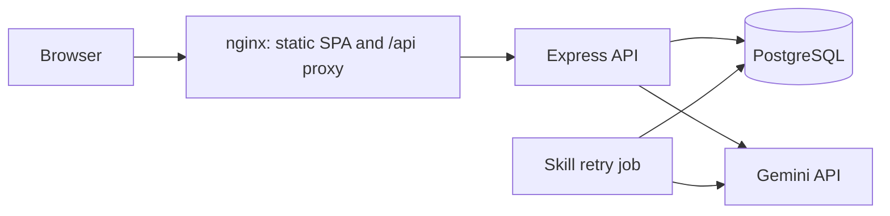
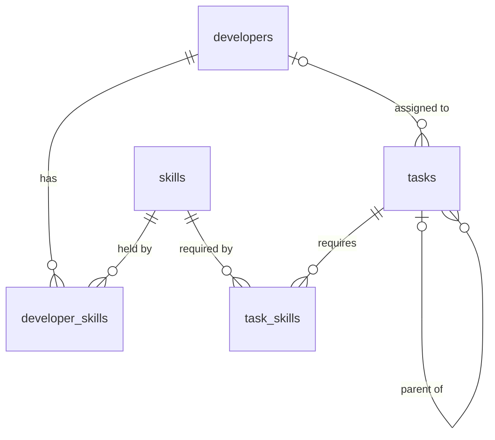
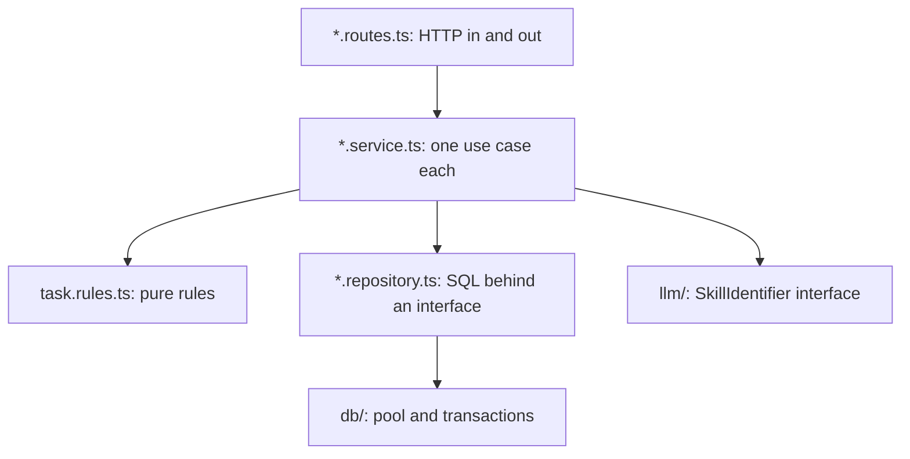

# Design decisions

This document explains why the application is built the way it is. It starts with the choices that shape the whole system, then goes through each component in turn. Each section names the alternatives I considered and why I didn't choose them.

For setup, configuration and the API reference, see the [README](../README.md).

**Contents**

1. [What drove the design](#1-what-drove-the-design)
2. [System-level decisions](#2-system-level-decisions)
3. [Data model](#3-data-model)
4. [Business rules and consistency](#4-business-rules-and-consistency)
5. [Backend components](#5-backend-components)
6. [LLM skill identification](#6-llm-skill-identification)
7. [Frontend components](#7-frontend-components)
8. [Testing strategy](#8-testing-strategy)
9. [Delivery: Docker and CI](#9-delivery-docker-and-ci)
10. [What I would change for production](#10-what-i-would-change-for-production)

---

## 1. What drove the design

Five priorities guided the trade-offs, in roughly this order.

1. **Correctness of the business rules.** The rules about skills, Done and assignees are the point of the app. They must hold under concurrent use, not only in the happy path.
2. **Graceful degradation around the LLM.** An external AI service is the least reliable dependency. Its failure should slow work down, not stop it.
3. **Extensibility without speculation.** Developer and skill management will probably come next. The code should make that easy without building it in advance.
4. **Low setup cost.** One command should start everything, with no database to install.
5. **Clarity for the people using it.** Managers triaging tasks should always be able to see why an option is unavailable.

Where these pulled against each other, the earlier priority usually won. For example, I kept a background retry job (more code) rather than let a task exist without known skills and be assigned freely (a broken rule).

---

## 2. System-level decisions

### 2.1 Overall shape: a single-page app, an API, and PostgreSQL



The frontend is a static SPA served by nginx, which also proxies `/api` to the backend. The browser therefore sees a single origin:

- **No CORS needed for the bundled frontend.** CORS stays off by default and can be enabled for other clients by configuration.
- **No hard-coded API URL.** The same frontend build works in every environment.
- **Production-like local development.** Vite's dev server proxies `/api` the same way.

**Alternatives considered.**
- **A full-stack framework like Next.js** would add server rendering, which this internal tool doesn't need. It would also blur the frontend/backend split the brief asks for.
- **Serving the SPA from Express** would remove nginx. However, nginx is better at static files, keeps the API process focused, and is a common production setup.

### 2.2 Embedded PostgreSQL by default, real servers by configuration

The backend can start PostgreSQL itself (`DB_MODE=embedded`, the default) or connect to any server (`DB_MODE=external`). Only [`db/database.ts`](../backend/src/db/database.ts) knows which mode is in use. Everything else receives a connection pool.

- **Why embedded is the default:** a clean clone runs with no database setup, and tests run against real PostgreSQL rather than an imitation like pg-mem, which differs in subtle ways.
- **Why external is a first-class option:** embedded mode limits you to one backend instance, and its npm package is only published with beta version tags. A production deployment should use a managed server, which is a configuration change, not a code change.
- **Keeping both modes equivalent:** the schema uses only standard PostgreSQL features, so behaviour is identical in both. Both modes were verified in Docker with the same scenario script.

### 2.3 A contract-first API

The API is defined by zod schemas that do three jobs:

1. They validate requests at runtime.
2. They provide TypeScript types to the backend.
3. They generate the OpenAPI document.

The frontend's types are then generated from that document. One definition therefore flows to validation, documentation and the client, so these can't drift apart silently:

- **The docs can't drift from the API:** a test fails if the committed `openapi.json` is stale.
- **The frontend types can't drift from the docs:** CI fails if the generated types are stale.
- **The schemas can't lie about responses:** integration tests validate real API responses against the published schemas.

**Alternative considered: an npm workspace with a shared types package.** It would avoid the generation step. However, it would force both Docker builds to use the repository root as their build context, coupling the images. Generating types keeps each package independently buildable, at the cost of one command when the API changes.

### 2.4 Versioning and a consistent response shape

- **Versioned paths:** routes live under `/api/v1`, so a future breaking change can ship as `/api/v2` alongside it.
- **Consistent success shape:** successful responses are `{ "data": ... }`, which leaves room for metadata such as pagination later without breaking clients.
- **Consistent error shape:** errors are `{ "error": { "code", "message", "details" } }`. Clients branch on the stable `code`, show `message` to users, and use `details` for specifics such as which skills are missing.

### 2.5 Synchronous creation, with asynchronous recovery

When a task is created without skills, the backend calls the LLM **during the request**, and the response includes the identified skills. This keeps the common case simple: the user sees the result straight away, with no polling.

If the LLM fails, the task is saved anyway as "pending", and a background job retries it later (see [section 6](#6-llm-skill-identification)). This hybrid gives immediate results when the LLM works, without making task creation depend on it.

**Alternatives considered.**
- **Fully synchronous, failing the request on LLM error.** This was the first version. It is simpler, but an LLM outage blocks all task creation without chosen skills.
- **Fully asynchronous through a queue.** This is more robust at scale, but every user would wait for skills even when the LLM is healthy. It also needs queue infrastructure this app doesn't justify.

### 2.6 Two independent packages, not a monorepo tool

`backend/` and `frontend/` each have their own `package.json` and lockfile, with no Nx, Turborepo or workspaces. The packages share nothing at runtime, and the generated-types approach in section 2.3 covers the only shared concern. A monorepo tool would add configuration to learn for no practical gain at this size.

---

## 3. Data model



### 3.1 Skills as rows, with join tables

The brief says skills aren't unique to a developer, and tasks can need several. Both relationships are many-to-many, modelled as `developer_skills` and `task_skills`:

- **Integrity:** each join table has a composite primary key, which also prevents duplicates, plus foreign keys.
- **Lookups both ways:** an index on `skill_id` serves queries that start from the skill.
- **Deletion behaviour:** foreign keys to `skills` use `ON DELETE RESTRICT`, so a skill in use can't vanish. Foreign keys to tasks and developers use `CASCADE`, so removing an owner removes its links.

Skills are data, not an enum, because the app should extend to new skills without code changes. Nothing in the code or UI names a particular skill; only the seed data does. Each skill also has a `description` column, which feeds the LLM prompt (see [section 6](#6-llm-skill-identification)).

### 3.2 Subtasks as an adjacency list

A subtask is a row in `tasks` with a `parent_task_id`. This satisfies "each subtask has the same properties as a Task" without a separate table or duplicated columns.

| Option | Reads a subtree | Moves | Complexity | Verdict |
| ------ | --------------- | ----- | ---------- | ------- |
| **Adjacency list** (chosen) | One recursive CTE | Change one column | Lowest | Fits: trees are small and never moved |
| Closure table | One join | Many rows rewritten | Extra table and triggers | Pays off for deep, frequently queried hierarchies |
| `ltree` materialised path | Index-friendly | Path rewrites | An extension | Non-standard, which would complicate external mode |
| Nested sets | Fast | Expensive | Highest | Poor fit for frequent inserts |

**Cycles** are impossible by construction. A parent is set once at insert time, and no API changes it. A `CHECK (parent_task_id <> id)` guards against direct self-reference. I deliberately didn't add a cycle-detection trigger, because no code path could create a cycle. If re-parenting is ever added, that change should add the guard.

### 3.3 Enums for small, fixed vocabularies

`task_status` (`To-do`, `In Progress`, `Done`) and `skills_source` (`user`, `llm`, `pending`) are PostgreSQL enum types:

- **The database rejects invalid values,** whatever client writes them.
- **They appear in the OpenAPI document** and the generated frontend types.
- **Adding a value is one migration** (`005_add_pending_skills_source.sql` is an example).

A lookup table would let statuses be managed at runtime, which nobody needs, and every status rule in code would still have to name them.

### 3.4 Other column choices

- **Primary keys** are `INT GENERATED ALWAYS AS IDENTITY`, the standard SQL form of auto-increment. They're compact and readable in URLs. UUIDs would matter if ids were generated by clients or merged across systems, and neither applies.
- **`skills_source`** records where a task's skills came from. It drives the "Auto-detected" label (transparency about AI output), the pending state, and the retry job's work queue.
- **Timestamps** are `TIMESTAMPTZ`, so they're unambiguous across time zones.
- **A partial index** `ON tasks (id) WHERE skills_source = 'pending'` keeps the retry job's polling cheap, however many finished tasks exist.
- **Titles** must contain non-blank text (`CHECK (btrim(title) <> '')`) at the database level, as well as in the API.

### 3.5 Where the rules are enforced: database or service

Constraints that are true of any row live in the database: required columns, valid enum values, foreign keys, and no blank titles. Rules that depend on other rows, or on what is changing, live in the service layer:

- skill matching on assignment
- the Done rule
- the assignee rule for moving forward

**Alternative considered: database triggers.** They would also catch writes that bypass the API. However, they would split business logic across SQL and TypeScript, make the rules harder to read and test, and produce generic database errors instead of specific codes like `SUBTASKS_NOT_DONE`. With the API as the only writer, the service layer is the clearer place, and row locks (see [section 4.2](#42-concurrency-row-locks-taken-parent-first)) close the race windows a trigger would otherwise cover.

### 3.6 Versioned migrations and a separate seed

- **Migrations** are plain SQL files, numbered and applied once each, in order. Each runs in its own transaction, so a failed migration leaves no partial change.
- **Seed data** is a separate step that only inserts what's missing, so it's safe to run repeatedly.

Keeping them apart means reference data never gets tangled with schema history. For example, re-running the seed after someone deletes a row restores it, which a migration couldn't do.

`developers.name` is deliberately **not** unique, because real names repeat. The seed therefore matches existing developers with `WHERE NOT EXISTS` rather than `ON CONFLICT`.

---

## 4. Business rules and consistency

### 4.1 The rules

| Rule | Error | Notes |
| ---- | ----- | ----- |
| A developer must have **every** skill a task requires | 422 `DEVELOPER_MISSING_SKILLS` | The brief's "with the Skill(s) required" is read as all, not any |
| A task with **pending** skills can't be assigned | 409 `TASK_SKILLS_PENDING` | Nobody can be shown to qualify for unknown requirements |
| An **unassigned** task can move backwards but not forwards | 409 `TASK_UNASSIGNED` | Judged on the assignee *after* the update |
| A task can be `Done` only when **all direct subtasks** are `Done` | 409 `SUBTASKS_NOT_DONE` | Holds for the whole tree, as each level enforces it |
| A subtask can't leave `Done` while its **parent is `Done`** | 409 `PARENT_TASK_DONE` | Otherwise a `Done` parent would have an unfinished subtask |

Every rule is a small pure function in [`task.rules.ts`](../backend/src/features/tasks/task.rules.ts), with no database or HTTP code, so each is unit tested in isolation.

**Choosing a status code.**
- **409 Conflict** means the request is valid, but the task's current state doesn't allow it, so it may succeed later once something else changes.
- **422 Unprocessable** means the request refers to something unsuitable, such as a developer lacking a skill, and won't succeed as written.

**The assignee rule in detail.**
- **Direction matters:** statuses are ordered `To-do` → `In Progress` → `Done`. Without an assignee, any move backwards is allowed and any move forwards is rejected. Progress needs an owner, but stepping back, such as pausing or reopening work, shouldn't be blocked just because nobody owns the task right now.
- **Judged after the update:** "assign Alice and start" in one request succeeds, and "unassign and start" fails.
- **Unassigning is always allowed:** a task underway can lose its assignee, for example when its developer moves on. It then stays where it is, and can step back but not forward until someone is assigned.
- **Unassigning started work asks first.** The API allows it, but the UI asks for confirmation, because it loses information: who owns work in progress, or who completed finished work. For an `In Progress` task, the prompt says it can't move forward until someone is assigned. For a `Done` task, it says the record of who completed it will be lost. This is a warning rather than a rule, because there are legitimate reasons to do it. See [section 7.4](#74-the-task-list-page).
- **Interacts with the other rules:**
  - A parent can't be `Done` until all its subtasks are assigned and `Done`.
  - A pending task can't be started until its skills are known.

**Reopening under a `Done` parent is rejected, not cascaded.** Reopening the parent automatically would also keep the tree consistent, but it would change a task nobody asked to change. Being explicit is easier to reason about and to audit.

### 4.2 Concurrency: row locks taken parent first

Checking a rule and then writing creates a race. For example, request A marks a parent `Done` after seeing its subtask is `Done`, while request B reopens that subtask at the same moment. Both checks pass, and the tree ends up inconsistent.

Each update therefore runs in one transaction with this protocol:

1. Read the task's `parent_task_id`. This is safe without a lock because it never changes.
2. Lock the **parent** row (`FOR SHARE`).
3. Lock the task's own row (`FOR UPDATE`), reading its status, assignee and skills.
4. Check the rules, then write.

Whichever of A and B locks the shared parent row first finishes first, and the other then sees its result. Locks are always taken parent before child, so two requests can never wait on each other in a cycle, which rules out deadlocks. An integration test runs these two requests concurrently 25 times and checks the rule always holds.

The same row lock also serialises requests that unassign and start the same task, so the assignee rule can't be raced either.

### 4.3 All-or-nothing writes

- **Creating a tree:** a task and its subtasks are inserted in one transaction, so a failure part-way saves nothing.
- **Updating status and assignee together:** if either part fails, neither is applied, and a test covers this.
- **Validating first:** request validation and unknown-skill checks run before any write, so the common errors never open a transaction.

---

## 5. Backend components

### 5.1 Layering



Each feature (`tasks`, `developers`, `skills`) has the same four files: routes, service, repository and schemas. Dependencies only point downwards:

- **Routes** turn HTTP into calls and results into responses. They hold no logic.
- **Services** coordinate a use case. They depend on repository **interfaces**, not on `pg`, so the service unit tests run against in-memory fakes with no database.
- **Repositories** contain all the SQL. `TaskRepository.transaction()` hands the service a `TaskTransaction` object whose methods share one connection, so services control transaction boundaries without touching a database client.

This is why adding developer or skill management means adding one method per layer, and nothing else moves.

**Why plain factory functions instead of classes or a DI container.** `createTaskService({ tasks, skills, ... })` is explicit about its dependencies, trivial to fake in tests, and needs no decorators or reflection. **NestJS** would provide this structure out of the box, but would also bring a large framework and its conventions to a five-endpoint API.

**Why `pg` and SQL instead of an ORM.** The important queries are a recursive CTE, `FOR SHARE`/`FOR UPDATE` row locks in a specific order, and JSON aggregation to avoid N+1 queries. These are clearer in SQL than in an ORM's query builder, which often needs raw-SQL escape hatches for exactly these cases. The cost is some hand-written row mapping, which is small here. **Prisma or Drizzle** would pay off in a larger schema with many simple CRUD tables.

### 5.2 Avoiding N+1 queries

- **Task lists and subtrees** come from one query. Skills are aggregated into JSON in a correlated subquery, and the assignee is joined.
- **Building the tree** is done in memory by `buildForest`, linking rows by `parent_task_id` in a single pass.
- **Developers** come with their skills and assigned tasks in one query, using the same aggregation technique.

### 5.3 Validation at the boundary

Every request body and path parameter is validated with zod before reaching a service, so services receive typed, trusted input:

- **No unexpected fields:** schemas are strict, so a misspelled field is reported rather than silently ignored.
- **Trimmed titles:** titles are trimmed and limited to 500 characters.
- **Ids that fit the database:** ids are checked against PostgreSQL's `INT` range, so a huge id returns 400 instead of a database error.

**Tree size limits** (100 tasks, 10 levels) are checked by a short iterative walk **before** zod parses the tree. Zod's recursive parsing could exhaust the call stack on a maliciously deep payload, crashing the request with a 500 instead of a clear 400.

### 5.4 Errors

Services throw `AppError` with a **kind** (`invalid`, `not_found`, `conflict`, `unprocessable`, `rate_limited`) and a stable **code**. Only [`http/errorHandler.ts`](../backend/src/http/errorHandler.ts) maps kinds to HTTP statuses, so services stay independent of HTTP.

The handler also deals with other errors:

- **Validation failures** become 400 `VALIDATION_ERROR`, with the path of each invalid field.
- **Malformed or oversized bodies** become 400 `BAD_REQUEST`.
- **Anything else** is logged with its full cause and returned as a generic 500, so internal details never reach clients.

### 5.5 Configuration

[`config/env.ts`](../backend/src/config/env.ts) validates all environment variables once at startup:

- **The database settings are a discriminated union on `DB_MODE`.** In external mode, `DATABASE_URL` is required, and its absence is reported as such, not as a generic error.
- **All problems are reported at once,** so a misconfigured deployment can be fixed in one pass.
- **Messages name the variable and the rule, never the value,** because values may be secrets. A test checks this.
- **Empty strings count as unset,** because Docker Compose passes unset variables as empty strings.

### 5.6 The database module

- **[`db/database.ts`](../backend/src/db/database.ts)** is the only module aware of the mode. `openDatabase()` returns `{ pool, close() }`. In embedded mode, the embedded module is loaded by dynamic import, so external mode never touches the binaries. The pool has a 5-second connection timeout, so a missing database fails quickly.
- **[`db/embedded.ts`](../backend/src/db/embedded.ts)** creates the data directory on first run, creates the database if missing, and explicitly listens on localhost only. Its library rejects with no value when startup fails, usually because another process holds the data directory. The module turns that into a clear message.
- **[`db/migrate.ts`](../backend/src/db/migrate.ts)** is a short custom runner. A PostgreSQL advisory lock stops two instances migrating at once. A migration library would add features such as down-migrations and checksums that this app doesn't need.

### 5.7 HTTP concerns

[`http/app.ts`](../backend/src/http/app.ts) assembles the app in this order:

1. `trust proxy`, so rate limiting sees real client addresses behind nginx
2. `helmet`, for security headers
3. optional CORS
4. request logging
5. a 100 KB body limit
6. the rate limiter
7. the routes and docs
8. the 404 handler and the error handler

- **Rate limiting** applies to `/api` only. `/health` is left out, so Docker's frequent health checks can't use up the budget. The main reason for the limit is that `POST /tasks` can spend LLM quota.
- **Swagger UI** gets its own, slightly looser Content Security Policy, because it needs inline styles. The rest of the API keeps helmet's strict default.
- **The health check** runs `SELECT 1` and returns 503 when the database is unreachable, so orchestrators can tell a live process from a working one.

### 5.8 Logging and shutdown

- **Structured logs:** pino writes JSON logs with per-request context. Authorization and cookie headers are redacted, and LLM failures are logged with their full cause chain but never the API key.
- **Graceful shutdown:** on `SIGTERM`, the server stops accepting connections, the retry job finishes any run in progress, the pool drains, and the embedded database stops cleanly. In Docker the backend exited with code 0 on stop.

---

## 6. LLM skill identification

### 6.1 A provider-independent interface

```ts
interface SkillIdentifier {
  identify(titles: string[], availableSkills: SkillOption[]): Promise<string[][]>;
}
```

Gemini is one implementation. The rest of the app depends only on this interface, so changing provider means writing one class. The prompt builder and answer parser are separate modules, so a new provider can reuse them.

### 6.2 One batched call per tree

All tasks without skills in a tree go to the LLM in a single request. Compared with one call per subtask, this is faster, uses less of the free tier's rate limit, and gives the model the context of related titles.

### 6.3 Prompting

- **No skill names in the code.** The prompt lists the skills and descriptions from the database, so new skills reach the LLM automatically. I removed the brief's three examples from the prompt, because they named specific skills. With the database descriptions alone, the live model still classified all three correctly on every run.
- **Constrained output.** The request sets a JSON response schema whose skill values are limited to the known skill names, with temperature 0 for consistent answers.
- **Untrusted titles.** Titles are sent inside JSON data, and the instructions tell the model not to follow anything written in them. Even a successful prompt injection could only choose among valid skills.

### 6.4 Validating the answer

The schema in the request is a request, not a guarantee, so [`parseAnswer`](../backend/src/llm/parseAnswer.ts) validates the response again:

- **Text that isn't the expected JSON** is an error, and that attempt is retried.
- **Each title is validated separately.** Unknown skill names are dropped, and a title left with no valid skills gets an empty list rather than failing the whole batch.

### 6.5 Reliability

- **Timeouts and retries:** each attempt has a 15-second timeout, with up to 3 attempts and exponential backoff (0.5s, then 1s).
- **Retrying partial answers:** if some titles come back unresolved, the call is retried. If retries run out, the best partial answer is used, so the resolved titles aren't thrown away.
- **Fallback:** if no usable answer arrives at all, the affected tasks are saved as `pending` and a warning is logged. Programming errors such as a `TypeError` are deliberately **not** caught, so a bug can't be mistaken for an outage.

### 6.6 The retry job

[`jobs/retryPendingSkills.ts`](../backend/src/jobs/retryPendingSkills.ts) resolves pending tasks in the background:

- **Batches:** each run takes up to 20 pending tasks and makes one LLM call for all of them.
- **No locks during the LLM call:** no transaction or row lock is held while waiting, so a slow LLM can't block other requests.
- **Conditional update:** the write only applies `WHERE skills_source = 'pending'`, so if two backend instances resolve the same task, the second write does nothing.
- **No overlapping runs:** the job schedules its next run only after the current one finishes, rather than using `setInterval`.
- **Only runs with a key:** without an API key there's nothing to retry with.

**Alternative considered: a job queue such as BullMQ.** It would add Redis to the stack for one periodic task. The database already holds the queue in effect: the pending rows themselves.

---

## 7. Frontend components

### 7.1 Stack

| Choice | Why | Alternatives |
| ------ | --- | ------------ |
| **React 19 and TypeScript** | Required by the brief | — |
| **Vite** | Fast development server and simple production build for an SPA | Next.js: server rendering is unnecessary here |
| **React Router (data router)** | URL-backed filters, and `useBlocker` for the discard confirmation, which needs the data router | TanStack Router: also good, but the team is more likely to know React Router |
| **TanStack Query** | Server state, meaning caching, refetching, optimistic updates with rollback, and ordered mutations | Redux or Zustand: these manage client state, and server state is the hard part here. Hand-rolling it would mean more code and more bugs |
| **Plain CSS with custom properties** | The UI is small, and design tokens give consistency and dark mode without a dependency | Tailwind or MUI: worthwhile for a larger UI or a shared design system |

### 7.2 Structure

```text
src/
  app/           routes and layout: what the app is made of
  features/
    tasks/       api/, components/, lib/, pages/
    developers/  api.ts
    skills/      api.ts
  shared/
    api/         typed request helper and generated types
    ui/          Toast, ConfirmDialog, ErrorBanner, page titles
```

Code is grouped by feature rather than by file type. Everything for tasks lives under `features/tasks`, so a future skills management page has an obvious home. Pure logic sits in `lib/` (`taskTree.ts`, `taskRules.ts`, `taskDraft.ts`), separate from components, and is unit tested directly.

### 7.3 The API layer

- **[`shared/api/http.ts`](../frontend/src/shared/api/http.ts)** has one `request<T>()` function. It unwraps the `{ data }` envelope and throws an `ApiError` carrying the server's message and code, so every screen can show the server's explanation, such as "This developer lacks skills required by the task: Backend."
- **[`shared/api/types.ts`](../frontend/src/shared/api/types.ts)** re-exports the generated OpenAPI types under readable names, so components never import the generated file directly.
- **Query hooks** (`useTasks`, `useUpdateTask`, ...) wrap TanStack Query. Components never call `fetch` themselves.

### 7.4 The task list page

**Tree rendering.** [`TaskRow`](../frontend/src/features/tasks/components/TaskRow.tsx) renders a row, then recurses for each subtask, increasing the indentation. I kept a semantic `<table>` rather than an ARIA `treegrid`: a treegrid requires custom arrow-key navigation, which is easy to get wrong. A table with real buttons (`aria-expanded`) for expanding and collapsing gives screen reader and keyboard users a reliable experience.

**Progress** ("2/3 done") counts direct subtasks, matching the Done rule, so the number shows what stands between a task and `Done`.

**Filters, search and sort**:
- **Kept in the URL,** so a filtered view can be bookmarked or shared and survives a refresh. Updates replace the browser history entry, so each keystroke in search doesn't add a Back step.
- **Applied on the client,** because every task is already loaded. Results are instant, with no extra endpoints to maintain.
- **Sensible tree semantics:** when a subtask matches, its ancestors stay visible but muted, so the match is shown in context. Expand and collapse are disabled while filtering, so a collapsed parent can't hide a match.
- **Sorting** applies to top-level tasks only. Subtasks keep their written order, which usually reflects the planned sequence.
- **Hand-edited links can't break the page:** an unknown status or sort falls back to the default, and an unknown skill or developer simply matches nothing.

**Explaining unavailable choices.** This is the main UX principle of the page. Hiding options makes users wonder whether data is missing, so options are disabled and the reason is shown:

- **Developers lacking skills** appear disabled with the reason, such as "Bob (missing Frontend)".
- **Blocked statuses** are disabled, with a hint under the control, linked by `aria-describedby` so screen readers announce it. The hint shows the most relevant reason:
  - "Locked: reopen the parent task to change this."
  - "Assign someone to move this task forward."
  - "Done unlocks when all subtasks are Done."
- **Pending tasks** show "Detecting skills…" and "Assignable once skills are detected."

The frontend checks mirror the backend rules for a better experience, but **the backend remains the authority**. If the two ever disagree, the server's rejection is shown, and the change is rolled back.

**Native `<select>` rather than a custom dropdown.** Native controls give keyboard, screen reader and mobile behaviour for free. The cost is that options can only hold text, so explanations are written in the option label or in a hint below the control. Tooltips weren't used, because they can't be reached by keyboard or touch.

**Confirming destructive changes.** Unassigning an `In Progress` or `Done` task opens a confirmation dialog, which explains what will be lost for that status. Cancelling sends nothing, and the dropdown keeps showing the current developer. Confirmations are kept to changes that lose information. Unassigning a `To-do` task, or switching to another qualified developer, doesn't ask, because asking too often trains people to click through without reading. Keyboard focus defaults to the safe button ("Keep Carol"), and closing the dialog returns focus to the dropdown.

**Optimistic updates.** Changing a status or assignee updates the screen at once:

1. Cancel in-flight fetches, so a slow response can't overwrite the change.
2. Snapshot the current list, then apply the change to the cached data.
3. On error, restore the snapshot and show the server's message.
4. When the request settles, refetch tasks and developers to match the server.

Each task's changes share a **mutation scope**, so quick successive edits to one task reach the server in order. For example, assigning then starting won't arrive as starting then assigning, which the server would reject.

**Polling only while needed.** The list refetches every 5 seconds only while some task has pending skills, so resolved skills appear without a refresh, and an idle list makes no requests.

**Loading and error states.** Skeleton rows match the table layout, so the page doesn't jump when data arrives. The empty state links to task creation. When filters match nothing, the page offers to clear them. A load failure shows a retry button instead of a blank page.

### 7.5 The task creation page

**Draft model.** The form state is one tree of `TaskDraft` nodes (`key`, `title`, `skillIds`, `subtasks`), changed only through pure functions in [`taskDraft.ts`](../frontend/src/features/tasks/lib/taskDraft.ts) such as `appendSubtask` and `removeDraft`. These return new trees rather than mutating, which keeps React updates predictable and makes the logic easy to unit test. On submit, `toTaskInput` turns the draft into the API payload, dropping the client-only keys.

**Stable keys from a counter, not `crypto.randomUUID()`.** Browsers only provide `randomUUID` on secure origins (HTTPS or localhost). Opened over plain HTTP from another machine, the form would have crashed.

**Recursive editor.** [`TaskDraftEditor`](../frontend/src/features/tasks/components/TaskDraftEditor.tsx) renders one node, then itself for each subtask, computing the numbering (1, 1.1, 1.1.1) from its position. Actions arrive as one typed `actions` object rather than many separate callbacks, which keeps the recursive props manageable. Each node is a `<fieldset>` with a `<legend>` like "Subtask 1.1", so screen readers announce which task a field belongs to.

**Focus management**:
- **Adding a subtask** moves focus to its title, so keyboard users can type straight away.
- **Submitting with blank titles** flags every one and focuses the first.
- **Removing a subtask** moves focus to the parent's "Add Subtask" button, since the button that had focus no longer exists.
- **Changing page** moves focus to the page heading, so screen reader users know the page changed.

**Skill chips** are real checkboxes styled as pills, which keeps native keyboard and screen reader behaviour while looking like a modern multi-select. When no skill is chosen, a hint says the skills will be detected automatically with AI.

**Protecting unsaved work**:
- **Leaving the page** inside the app asks for confirmation through `useBlocker`. Closing the tab or reloading triggers the browser's own warning through `beforeunload`.
- **Untouched forms** don't ask, because there's nothing to lose.
- **A successful save** sets a flag before navigating, so the redirect itself isn't blocked.
- **Removing a subtask with nested subtasks** asks for confirmation. Removing a single subtask doesn't, as that's easy to redo.

**After saving**, the app returns to the list, highlights the new task, and shows a toast saying whether skills were auto-detected or are still pending. Auto-detected skills are labelled in the list. If saving fails, the form keeps everything entered.

### 7.6 Shared UI

- **`ToastProvider`** shows messages in an `aria-live` region, so screen readers announce them. Success and info messages disappear after a few seconds; errors stay until dismissed, so they can't vanish before being read.
- **`ConfirmDialog`** uses the native `<dialog>` element, which provides focus trapping, Escape to close and a backdrop with no extra code.
- **Design tokens** (colours, radii) are CSS custom properties, with a dark theme through `prefers-color-scheme`. Every text and background pairing was checked for WCAG AA contrast (at least 4.5:1) in both themes. Skeleton animation respects `prefers-reduced-motion`.
- **Responsive layout:** below 720px, table rows become cards with labelled fields, and the filter bar folds into two columns. At phone width the page doesn't scroll sideways.

---

## 8. Testing strategy

The tests target the places where bugs would matter most, through a few layers.

| Layer | What it proves | Example |
| ----- | -------------- | ------- |
| **Pure unit tests** | Each rule and helper is correct in isolation | `assertAssignedToMoveForward` for every status transition; `findVisibleTasks` keeps ancestors of matches |
| **Service unit tests** | The service applies rules in the right order and writes nothing on failure, with in-memory fakes and no database | An LLM `TypeError` isn't treated as an outage |
| **API integration tests** | The whole backend works against real PostgreSQL | Concurrent Done/reopen requests keep the tree consistent; responses match the OpenAPI schemas |
| **Database tests** | Both modes work, and data and seeding survive restarts | A second process on the same data directory fails with a clear message |
| **Component tests** | The pages behave correctly for users, found the way a user finds them (by role and label) | Optimistic update shows before the server answers, then rolls back on 409 |

Notes on these choices:

- **The LLM is always mocked.** Service tests fake the `SkillIdentifier`, and the Gemini client is tested against a local HTTP server, which checks the real request format without a key or network access.
- **Real PostgreSQL in tests.** Locking, recursive queries and enum behaviour are exactly what an imitation database gets wrong.
- **Frontend fixtures use made-up skills** ("Design", "Data"), so the tests prove the UI doesn't assume the seeded skills exist.

---

## 9. Delivery: Docker and CI

**Backend image**:
- **Multi-stage build:** the TypeScript compiler and dev dependencies stay out of the final image.
- **Debian slim rather than Alpine,** because the embedded PostgreSQL binaries need glibc.
- **Non-root:** it runs as the `node` user, which PostgreSQL requires anyway.
- **Install scripts enabled,** because the embedded package uses one to link its native libraries.
- **Process handling:** `init: true` gives the container a minimal init process, which forwards signals and cleans up the PostgreSQL child process.

**Frontend image.** A Node stage builds the app, then an unprivileged nginx image serves it on port 8080.

**Compose**:
- **Health checks** for every service, with `depends_on` conditions, so the frontend starts only after the backend is healthy.
- **The external `postgres` service** sits behind a profile, with a dependency marked `required: false`, so the default mode doesn't start it.
- **The frontend health check** targets `127.0.0.1` rather than `localhost`. Inside the container, `localhost` resolves to IPv6 first, which nginx doesn't listen on. This was found during Docker verification.

**CI** (`.github/workflows/ci.yml`) runs lint, format checks, type checks, tests and builds for both packages. It also fails if the generated API types are out of date.

---

## 10. What I would change for production

The brief excludes these, but they would come first in a real deployment:

1. **Authentication and authorisation.** Every endpoint is currently open.
2. **An external database** with backups, and more than one backend instance. The migration lock and conditional updates already allow this.
3. **Pagination and server-side filtering** once the task list grows beyond what's comfortable to load at once.
4. **A way to correct skills by hand,** both for a wrong LLM answer and for a task stuck as pending without a working key.
5. **Audit history** of status and assignment changes, which the conditional writes and single update path make straightforward to add.
6. **Keeping the backend private:** don't publish port 3000 directly, so all traffic goes through nginx and client addresses can't be spoofed to dodge the rate limit.
